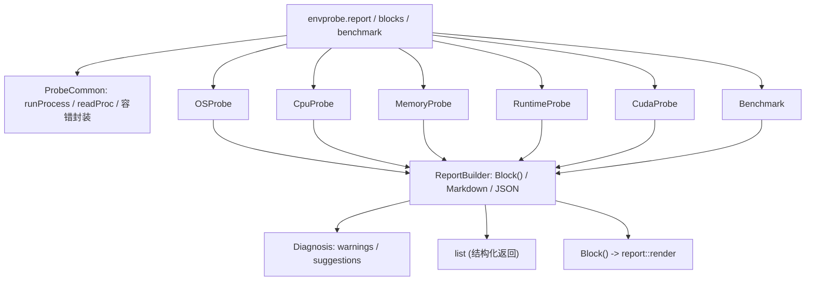

## 用户需求

在 `studio/Rsharp_kit/MLkit/MLkit-netcore5.vbproj` 中新增 R# 脚本 API 模块 `envprobe`，用于在 Windows / Linux 生产服务器上一次性采集所有可能影响计算资源（CPU 核心）利用率的运行环境状态，并输出可读诊断报告，帮助定位“开发机能跑满核、生产服务器只能用到部分 CPU”的原因。

## 产品概述

调用一个函数即可完成全量环境体检：既采集静态环境事实（系统版本、CPU 型号与可用核心、SIMD 指令集、内存容量、.NET GC 与线程池配置、CUDA/驱动、Linux 软件库），也执行轻量实测基准（单/多线程浮点吞吐扩展性、内存带宽），最后给出结论与优化建议。同一份数据可输出为结构化对象（便于脚本二次判断）、JSON（多机汇总比对）、Markdown（人工阅读），以及可被 `report::render` 直接渲染成 docx/pdf/html 的内容块数组。

## 核心功能

- `envprobe.report(file, json, benchmark)`：全量采集，返回嵌套结构；`file` 非空时写 Markdown 文本报告，`json` 非空时写 JSON 文件；`benchmark` 默认开启（约 1–5 秒），可关闭。
- `envprobe.blocks(benchmark)`：返回内容块数组，配合 `report::render(envprobe.blocks(), "diag.docx")` 生成 md/html/docx/pdf/rtf/xps。
- `envprobe.benchmark(threads)`：单独运行基准，输出各线程数的吞吐与并行效率。
- 采集范围：操作系统与内核/发行版/glibc、CPU 型号与主频/缓存/NUMA、物理核与可见逻辑核、进程亲和性、容器 cgroup（CPU/内存配额）、SIMD 指令集与向量宽度、物理内存与可用内存、.NET 运行时与 GC/线程池配置及相关环境变量、CUDA 路径/驱动/GPU、Linux 关键数学库与 OpenMP 库。
- 诊断结论：核心数不匹配、未开启 Server GC、SIMD 未被 JIT 启用、线程池下限过低、内存压力过大、并行扩展效率骤降（内存带宽/降频/超线程瓶颈）、CUDA 不可用等，逐条给出英文告警与优化建议。
- 报告为英文；探测项缺失时填 `n/a (reason)` 并计入告警，任何单项失败都不影响整体报告生成。

## 技术栈

- 语言/运行时：VB.NET，`net10.0`（与目标项目 `<TargetFrameworks>` 一致），无新增 NuGet 依赖。
- 宿主：R# 包模块机制（`<Package>` + `<ExportAPI>`，程序集级 `<Assembly: RPackageModule>` 已存在于 `MLkit\zzz.vb`）。
- 复用既有能力：
- `Microsoft.VisualBasic.Math.SIMD.SimdCapabilities`（`Core\src\Math\SIMD\Engine\SimdCapabilities.vb`）：SSE2/SSE4.2/AVX/AVX2/FMA/AdvSIMD 与 `Vector(Of T).Count`。
- `Microsoft.VisualBasic.ApplicationServices.Report.Block`（`Core\src\ApplicationServices\Report\Block.vb`）与同命名空间 `Extensions.ToMarkdown(IEnumerable(Of Block))`（`Core\src\ApplicationServices\Report\Extensions.vb`）。
- `ProgramPathSearchTool.Which`（`Core\src\ApplicationServices\FileSystem\ProgramPathSearchTool.vb`）做可执行文件定位。
- `Microsoft.VisualBasic.MIME.application.json`（Core 已引用）做 JSON 序列化。
- R# 运行时：`list`（`.slots`）、`RInternal.debug.stop`、`pipeline.Stream(Of Block)`。

## 实现方案

采用“采集器 + 归一化模型 + 渲染器”三层结构，全部为新增文件，不改动任何既有文件与 `vbproj`（SDK 默认通配 `**/*.vb` 自动编译新增目录）。

**关键决策**

1. **不引入新抽象层，沿用 R# 包现有形态**：`<Package("envprobe", Category:=APICategories.UtilityTools)>` 修饰 `Module`，三个 `<ExportAPI>` 直接返回 `list` / `Block()`；纯 ExportAPI 模块无需 `Sub Main()`，因此 `zzz.vb` 的 `onLoad` 也不用改（参考 `webKit\URL.vb`）。
2. **`Block()` 可直接穿透到 `report::render`**：`RMethodInfo.Invoke` 原样返回 CLR 结果，`pipeline.Stream(Of Block)` 命中的是 `TypeOf upstream Is IEnumerable(Of T)` 分支，因此无需 `RTypeExport` 注册，也无需在 R 侧做转换。
3. **不依赖 `PlatformUtility.ExecCommand`**：该方法只读取一行输出（`ReadLine` 后即 `WaitForExit`），无法承载 `nvidia-smi` 多行结果。改为在 `ProbeCommon` 内自建 `runProcess(name, args, timeout)` 私有助手（读全部 stdout/stderr、超时 `Kill`、失败返回空串），仅在定位可执行文件时复用 `ProgramPathSearchTool.Which`。
4. **探测失败必须是“数据”，不能是异常**：每个探测项统一产出 `(name, value, status)`，顶层 `report()` 全程 `Try/Catch` 包裹，缺失项填 `n/a (reason)` 并写入 `diagnosis.warnings`。
5. **跨平台分支显式隔离**：所有 `DllImport("kernel32"/"ntdll")` 调用都必须先经 `RuntimeInformation.IsOSPlatform(OSPlatform.Windows)` 判断，Linux 路径禁止触碰 kernel32；Linux 探测先做 `File.Exists` 再 `ReadAllLines`，兼容被裁剪的容器 `/proc`。
6. **基准成本可控**：固定迭代次数 + 预热，线程梯度取 `1,2,4,8,...` 且不超过可用逻辑核数，单次 `Stopwatch` 计时；内核循环内不分配、使用预分配数组并 `GC.KeepAlive` 防止被优化掉；整体目标 < 5 秒，异常全部转成 `n/a`。

**性能考量**

- 探测复杂度为 O(文件数 × 行数)，`/proc/cpuinfo` 与 `/etc/os-release` 各只读一次并缓存；`which`/`nvidia-smi` 结果在单次 `report()` 内缓存复用，避免重复进程启动。
- 基准为纯计算热点，采用 `Vector(Of Double)` 顺序写 + 单次归约，避免在内层循环使用 LINQ 或装箱。
- 报告渲染为一次性字符串拼接（`StringBuilder`），`Block()` 数量预计 < 100。

**避免技术债**

- 复用 `SimdCapabilities` 而非重写指令集探测，只补充其未覆盖的 AVX-512 家族（`Avx512F`/`Avx512BW`/`AvxVnni`，`net10.0` 可用）。
- 复用 `ToMarkdown` 生成 Markdown，避免手写第二套渲染逻辑。
- 不修改现有任何 API、不改 `vbproj`、不新增 NuGet，爆炸半径限制在新增目录内。

## 架构设计



数据流：各 `*Probe` 产出的扁平键值对汇总进 `ProbeSection` 集合 → `Diagnosis` 依据规则扫描生成结论 → `ReportBuilder` 同时产出 `list.slots`、Markdown 文本、JSON 字符串与 `Block()`。

## 目录结构

所有文件均为新增，`MLkit-netcore5.vbproj` 无需修改（SDK 通配自动包含）。

```
studio/Rsharp_kit/MLkit/
├── MLkit-netcore5.vbproj            # [NO CHANGE] SDK 通配已包含新目录
└── envprobe/
    ├── envprobe.vb                  # [NEW] 包入口。Module envprobe，<Package("envprobe", Category:=APICategories.UtilityTools)>。
    │                                #       实现 report / blocks / benchmark 三个 <ExportAPI>；负责参数默认值、
    │                                #       组装各探测结果、按扩展名写 md/txt、按路径写 json；失败返回 RInternal.debug.stop。
    ├── ProbeCommon.vb               # [NEW] 公共设施。ProbeItem / ProbeSection 数据模型；runProcess(name,args,timeout)
    │                                #       读全量 stdout/stderr 并超时 Kill；readProc(path) 行缓存读取；
    │                                #       formatBytes/formatSize 单位格式化；n/a 容错包装；工作集与页大小读取。
    ├── OSProbe.vb                   # [NEW] OS 段。RuntimeInformation.OSDescription/OSArchitecture/ProcessArchitecture、
    │                                #       Environment.Version、IntPtr.Size；Linux：/etc/os-release(PRETTY_NAME/ID/VERSION_ID)、
    │                                #       /proc/version、glibc 版本(ldd --version 或 libc.so.6 输出)、
    │                                #       LD_LIBRARY_PATH 中 libgomp/libiomp5/libomp/libmkl_rt/libopenblas 存在性；
    │                                #       Windows：OSVersion、ServicePack、是否 64 位系统。
    ├── CpuProbe.vb                  # [NEW] CPU 段。Environment.ProcessorCount；Linux /proc/cpuinfo
    │                                #       (model name/vendor_id/cpu MHz/cache size/physical id/core id/flags)、
    │                                #       去重统计物理核数、/sys/devices/system/node/node* 统计 NUMA 节点；
    │                                #       Linux /proc/self/status 的 Cpus_allowed_list；Windows 注册表
    │                                #       HKLM\HARDWARE\DESCRIPTION\System\CentralProcessor\0 与 GetProcessAffinityMask；
    │                                #       cgroup v2 (/sys/fs/cgroup/cpu.max、cpuset.cpus.effective、memory.max)
    │                                #       与 v1 (cpu.cfs_quota_us、cpu.cfs_period_us、cpuset.cpus) 配额解析，
    │                                #       计算 effectiveCpuLimit 与 ProcessorCount 的差值。
    ├── MemoryProbe.vb               # [NEW] 内存段。Linux /proc/meminfo (MemTotal/MemAvailable/SwapTotal/
    │                                #       HugePages_Total/Hugepagesize)；Windows GlobalMemoryStatusEx
    │                                #       (MEMORYSTATUSEX)；Environment.SystemPageSize；GC 侧可用内存兜底。
    ├── RuntimeProbe.vb              # [NEW] 运行时段。RuntimeInformation.FrameworkDescription、
    │                                #       GCSettings.IsServerGC / LatencyMode / GC.MaxGeneration、
    │                                #       GC.GetGCMemoryInfo 关键字段；AppContext 开关 System.GC.Server/Concurrent/RetainVM；
    │                                #       关注名单内的 DOTNET_*/COMPlus_* 环境变量（只读名字白名单，不导出全部环境变量）；
    │                                #       ThreadPool.GetMinThreads/GetMaxThreads/GetAvailableThreads/PendingWorkItemCount。
    ├── CudaProbe.vb                 # [NEW] CUDA 段。CUDA_PATH/CUDA_HOME/LD_LIBRARY_PATH；
    │                                #       nvidia-smi --query-gpu=name,memory.total,driver_version --format=csv,noheader；
    │                                #       libcuda.so.1 / nvcuda.dll / libcudart.so* / cudart64_*.dll 可见性；
    │                                #       全部失败时状态为 not available，不抛异常。
    ├── Benchmark.vb                 # [NEW] 基准段。单线程 SIMD(FMA 展开) GFLOPS 与标量 GFLOPS 及比值；
    │                                #       线程梯度吞吐与并行效率(speedup/threads)；内存带宽 Copy/Scale/Add/Triad；
    │                                #       Stopwatch 计时 + 预热 + 迭代上限 + 异常兜底，结果含实测耗时。
    ├── ReportBuilder.vb             # [NEW] 渲染段。把 ProbeSection 集合转成 (a) list.slots 字典，
    │                                #       (b) Block()：heading(1) 标题+时间戳主机名、每个 section heading(2)+table
    │                                #       (headers=Item/Value，rows 单元格数必须与 headers 长度一致)、必要时 code 块，
    │                                #       (c) Markdown 文本（复用 Extensions.ToMarkdown），(d) JSON 字符串。
    └── Diagnosis.vb                 # [NEW] 规则段。核心数不匹配、未开 Server GC、SIMD 硬件有但 JIT 未启用、
                                     #       线程池下限过低、内存可用率过低、并行效率骤降、CUDA 不可用等规则，
                                     #       输出英文 warnings/suggestions 与总体结论 paragraph。

test/unitTest/envprobe_demo.R        # [NEW] 演示脚本。imports "envprobe"；report/ blocks/ report::render 三种用法示例。
```

## 关键代码结构

仅约定对外契约，内部实现细节在实现阶段确定：

```
' 包入口签名（参数名即 R# 侧可见的命名参数）
&lt;Package("envprobe", Category:=APICategories.UtilityTools)&gt;
Module envprobe
    &lt;ExportAPI("report")&gt;
    Public Function report(Optional file As String = Nothing,
                           Optional json As String = Nothing,
                           Optional benchmark As Boolean = True,
                           Optional env As Runtime.Environment = Nothing) As Object
    &lt;ExportAPI("blocks")&gt;
    Public Function blocks(Optional benchmark As Boolean = True,
                           Optional env As Runtime.Environment = Nothing) As Object
    &lt;ExportAPI("benchmark")&gt;
    Public Function benchmark(Optional threads As Integer = 0,
                              Optional env As Runtime.Environment = Nothing) As Object
End Module
```

```
' 采集项归一化模型（新增类型，ProbeCommon.vb）
Public Class ProbeItem
    Public Property name As String
    Public Property value As String
    Public Property status As String   ' ok / warn / n-a
End Class

Public Class ProbeSection
    Public Property section As String
    Public Property items As ProbeItem()
End Class
```

## 实现注意事项

- **命名冲突**：R# 的 `SMRUCC.Rsharp.Runtime.Environment` 与 `System.Environment` 同名，且每个 `ExportAPI` 都需要 `env` 参数。统一使用 `Imports sys = System`（或 `Alias=System`）访问 `sys.Environment.ProcessorCount`、`sys.Environment.GetEnvironmentVariable`，避免歧义；参照 `MLkit\Manifold.vb` 的别名风格（`Rdataframe`、`RInternal`）。
- **`Block` 表格一致性**：`headers` 与每个 `rows(i)` 单元格数必须严格相等，否则 docx/pdf 渲染会错位；在 `ReportBuilder` 内用统一的 `addTable(section)` 辅助方法生成，禁止逐处手写。
- **返回值**：出错时返回 `RInternal.debug.stop(message, env)` 而不是抛异常，保持 R# 侧可捕获为 `Message`。
- **不要 dump 全量环境变量**：只读取白名单键名，避免泄漏凭据；不记录主机名以外的用户标识。
- **基准不得被 JIT 优化掉**：累加结果写入 `Public Shared` 字段或使用 `GC.KeepAlive`。
- **容器场景优先**：`ProcessorCount` 小于机器逻辑核数时，诊断文本必须直接点明 cgroup `cpu.max` / `cpuset` / 亲和性三种可能，并回显检测到的配额原值。
- **不改动既有文件**：不修改 `zzz.vb`（无 `Main()` 注册需求）、不修改 `MLkit-netcore5.vbproj`、不调整 `DefineConstants`。
- **测试**：若在实现过程中新增 console 型测试程序，必须按项目规则使用 `Microsoft.VisualBasic.Core\src\ApplicationServices\Debugger\DebugAudit.vb` 的方法记录测试结果并生成测试报告；纯 R# 演示脚本走 `test/unitTest/` 约定。

## Agent 扩展

### SubAgent

- **code-explorer**
- 用途：在实现 `ExportAPI` 之前核实 R# 运行时的参数绑定细节（`Optional Boolean` 默认值是否被 R# 正确识别、`Optional String = Nothing` 与未传参的映射、`<RApiReturn>` 是否需要、`Block()` 返回值在 `pipeline.Stream(Of Block)` 中的实际命中路径），并对比 `MLkit` 与 `Library/base/utils/report.vb` 的既有写法。
- 预期产出：一份明确的参数与返回类型绑定结论，确保 `envprobe.report(file = NULL, json = NULL, benchmark = TRUE)` 在 R# 侧可按命名参数调用，且 `report::render(envprobe.blocks(), "x.docx")` 一次通过，避免返工。