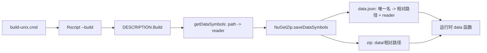

## 用户需求

修复 R# 程序包构建（`G:\cell-render\.pkg\build-unix.cmd`）时 `data/` 目录数据文件重名导致的打包中断，使 `CellRender.zip` 能正常生成并可安装。

## 问题本质

- 打包器将 `data/` 下所有 `csv/txt/rda/rds` 文件按 `BaseName` 注册为数据集名，`G:\cell-render\data\phypat+PGL\<trait>.ensemble\base\{0..4}\*.csv` 存在大量同名文件（`tables`×111、`booster`×54、`trees`×19、`coefficients`×19、`posterior-gaussian`×19），触发重名异常并中止打包。
- `data.json` 仅记录文件名而非真实相对路径，即使不重名，嵌套子目录数据也无法在运行时通过 `data()` 定位。

## 解决方案（已与用户确认）

- 顶层数据文件维持现有命名（如 `data(molecules)`、`data(subcellular.json)`），保持向后兼容。
- 嵌套目录 / 重名数据文件改用 `data/` 下的相对路径命名，例如 `phypat+PGL/00000_GC percentage.ensemble/base/0/tables`。
- `data.json` 的文件引用值改为 `data/` 下真实相对路径，使运行时可按路径加载子目录数据。
- 重名校验保留为最终断言：正常数据不再触发，异常时给出可定位的冲突清单。

## 预期效果

构建过程不再抛出 `DuplicateNameException`，产出完整 `CellRender.zip`；包内 769 个数据文件全部登记且名称唯一，嵌套数据可按相对路径读取。

## 技术栈

- 语言/运行时：VB.NET，.NET 10.0（`net10.0`），x64
- 目标工程：`G:\GCModeller\src\R-sharp\Rscript\Rscript.NET5.vbproj`（引用 `..\R#\Rsharp-netcore5.vbproj`，输出至 `..\App\`，即 `R_HOME=App\net10.0`）
- 涉及模块：`R#\System\Package\PackageFile\NuGet\WriteNuGetZip.vb`（打包）、`R#\Runtime\Internal\internalInvokes\utils.vb`（运行时 `data()` 加载）

## 实现思路

沿用现有 `PackageModel → NuGetZip` 打包管线，仅重构数据符号的“命名 + 文件引用”计算逻辑，不改动 CLI、DESCRIPTION、装配件打包、man 页面等其他环节。

1. **唯一命名管线（构建期）**

- 新增 `getDataRelativePath(dirBase, filepath)`：得到文件相对 `data/` 的 posix 路径（`\`→`/`、去前导 `/`），作为 `data.json` 的文件引用值。
- 保留 `getDataSymbolName` 作为“候选名”规则：无子目录的文件维持现状（表格类取 `BaseName`，其他保持带扩展名相对路径）；有子目录的文件取相对路径去掉扩展名。
- 新增冲突回退：按候选名分组成批检测，仅对发生冲突的组改用“带扩展名的相对路径”，因文件相对路径本身唯一，故必然可解；避免逐文件两两比较，整体复杂度 O(n)。
- 生成的 `Dictionary(Of String, NamedValue)` 直接作为 `package/manifest/data.json` 内容：key=数据集名，`name`=相对路径，`text`=reader 表达式；随后做一次唯一性断言（冲突时抛出的消息包含冲突名及对应文件，便于定位）。

2. **运行时加载（消费期）**

- `dataSearchByPackageDir()` 保持“key 查表 + `/data/{name}` 定位”的结构，仅对 `dataSymbols(name).name` 做 `\`→`/` 归一化，即可支持子目录；旧包（值为纯文件名）因顶层相对路径等于文件名而天然兼容。

3. **兼容性与风险控制**

- 顶层数据名与旧行为完全一致，已安装旧包读取路径不变。
- 子目录数据名含 `/`，不是合法 R 标识符，只能通过 `data("相对路径")` 显式字符串访问；这是用户已确认接受的取舍（相对路径命名）。
- 打包/安装冲突场景仍以断言形式失败，不会静默丢数据。

## 关键接口约定

```
' 取得文件相对 data/ 目录的 posix 相对路径，用于 data.json 的文件引用值
Private Function getDataRelativePath(dirBase As String, filepath As String) As String

' 候选数据集名（保持顶层文件的既有命名语义，子目录文件使用相对路径去扩展名）
Private Function getDataSymbolName(dirRoot As String, filepath As String) As String
```

## 架构与数据流



## 目录结构

```
G:\GCModeller\src\R-sharp\
└── R#\
    ├── System\Package\PackageFile\NuGet\
    │   └── WriteNuGetZip.vb   # [MODIFY] 数据符号命名与 data.json 写出：新增 getDataRelativePath；getDataSymbolName 明确“顶层保持原名 / 子目录取相对路径去扩展名”；saveDataSymbols 中按候选名分组成批处理冲突（冲突组回退为带扩展名相对路径），data.json 值由 FileName 改为相对路径；保留唯一性断言并输出冲突名与文件清单；data/ 条目写出复用同一相对路径计算，保证 index 与实体一致。
    └── Runtime\Internal\internalInvokes\
        └── utils.vb           # [MODIFY] dataSearchByPackageDir：对 dataSymbols(name).name 做 “\”→“/” 归一化后再拼接 /data/{path}，支持子目录数据加载，同时兼容旧包纯文件名取值；异常与命中逻辑不变。
```

## 执行注意

- 修改后必须重建 `Rscript.NET5.vbproj`（net10.0 / x64）才会影响 `App\net10.0\Rscript.exe`；仅改 `R#` 源码而不重建不会生效。
- 保留 VB 源文件顶部的自动生成统计注释块结构，改动限定在目标方法内，避免波及其他打包环节。
- 不修改 `getDataSymbols`（`CreatePackage.vb`）的 key/value 语义，不改 `.Rbuildignore`、不改 cell-render 项目的磁盘目录结构。
- 校验 zip 时以 `package/manifest/data.json` 的 key 唯一性（应为 769 个）与值为相对路径为准，并确认 `data/` 内条目保持原目录层级。

## Agent Extensions

### SubAgent

- **code-explorer**
- Purpose: 在动手改造前做一次精确影响面分析，确认 `getDataSymbolName` / `getDataRelativePath` 命名逻辑与 `data.json` 除已知两处外没有其他构建期或运行期消费方，避免改动遗漏
- Expected outcome: 输出一份调用方清单与结论（含文件路径与行号），确认修改范围仅限 `WriteNuGetZip.vb` 与 `utils.vb`，或补充出遗漏的调用点